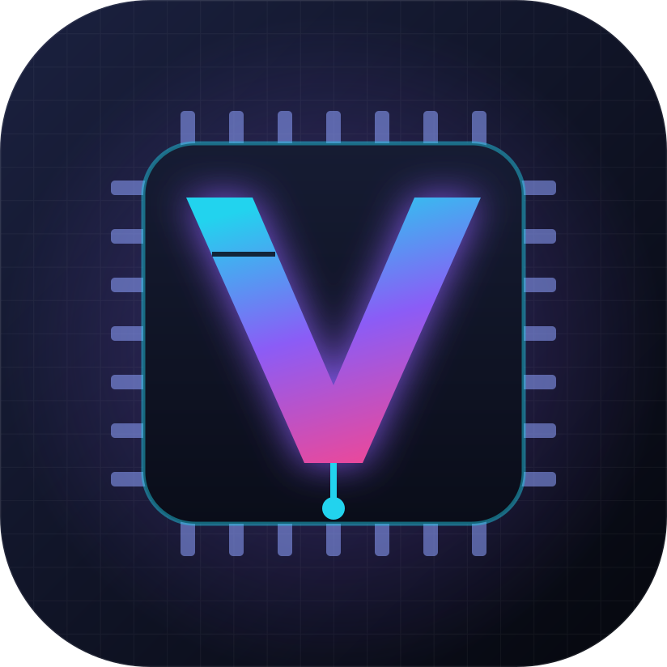
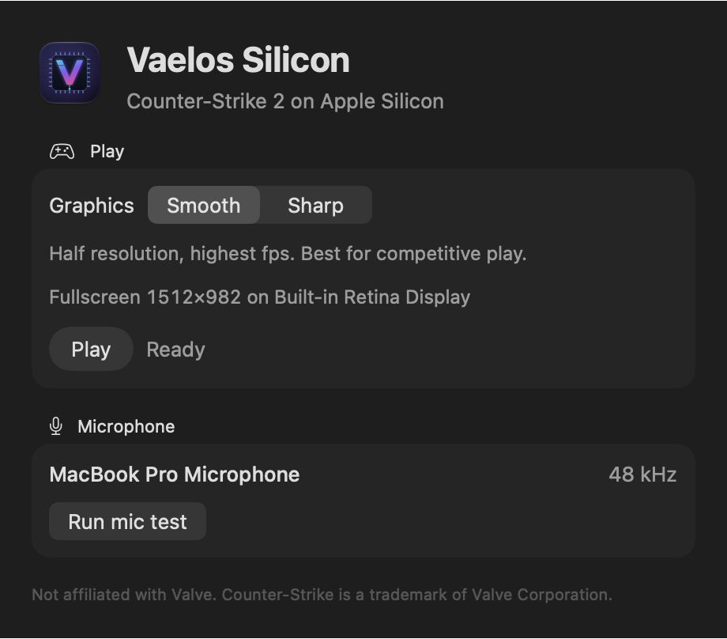

<p align="center">
  
</p>

<h1 align="center">Vaelos Silicon</h1>

<p align="center">
  <b>Counter-Strike 2 on Apple Silicon.</b> One window. Free. MIT.<br>
  <a href="https://vaelos-silicon.vercel.app">Download</a> ·
  <a href="docs/RESULTS.md">Benchmarks</a> ·
  <a href="docs/ARCHITECTURE.md">Architecture</a> ·
  <a href="SECURITY.md">Security</a>
</p>

---

CS2 has no macOS build. Vaelos runs the Windows build through **Wine 11 on Rosetta 2**, translates its
**Direct3D 11 to Metal with DXMT**, and fixes the things that make CS2 feel bad on a Mac: shader-compile
stutter, wrong-resolution fullscreen, a black Steam window, and voice chat that sounds like static.

| Measured on M2 Max, Dust2, 10 bots | Cold shader cache | **Vaelos (persistent cache)** |
|---|---|---|
| Average fps | 114 | **132** |
| 0.1% low fps | 12 | **30** |
| Freezes > 50 ms per minute | 16 | **1** |
| Worst frame | 192 ms | **75 ms** |

Full method and every run: [docs/RESULTS.md](docs/RESULTS.md).

<p align="center"></p>

## What it does

- **Per-process graphics routing.** `cs2.exe` loads DXMT (D3D11 → Metal) from its own folder through a
  per-app Wine DLL override; Steam's Chromium UI (`steamwebhelper.exe`) gets DXVK (D3D11 → Vulkan → MoltenVK →
  Metal), the only path on which it draws. One bottle, two translation layers, zero cross-talk.
- **Persistent Metal shader cache.** DXMT's pipeline cache lives in `~/Library/Application Support/Vaelos Silicon`,
  so compile hitches happen once, not every match: **−94% freezes** from the second launch on.
- **Display-aware fullscreen.** Reads the primary display at every launch. *Smooth* renders at the scaled size
  (1512×982 on a 14" MacBook Pro), *Sharp* flips Wine's Retina mode and renders native pixels (3024×1964).
  Always the current mode, so the panel never mode-switches.
- **Voice-chat diagnostics.** Flags Bluetooth headset mics (16 kHz HFP) before you queue, switches input to the
  built-in mic in one click, and runs a tone-fit test *through Wine's own capture path* (`waveIn`/`WAVE_MAPPER`,
  what CS2 uses) to find dropouts and clicks in 10 ms windows.
- **VAC-safe by construction.** The app never passes `-insecure`; that flag only exists behind `TEST=1` in the
  benchmark harness.

## Install

1. Install [Whisky](https://github.com/frankea/Whisky) (the free Wine engine Vaelos runs on):
   `brew install --cask frankea/whisky/whisky`, then open it once so it downloads its engine.
2. Download **Vaelos-Silicon.dmg** from [vaelos-silicon.vercel.app](https://vaelos-silicon.vercel.app) or
   [Releases](https://github.com/0xzcr/vaelos-silicon/releases/latest), and check it:
   `shasum -a 256 Vaelos-Silicon.dmg` must match `SHA256SUMS`.
3. Drag Vaelos Silicon to Applications. The build is ad-hoc signed, not notarized (no paid Apple Developer ID
   yet), so the first launch needs **System Settings → Privacy & Security → Open Anyway**.
4. Press **Set up** (creates the Windows environment and installs Steam from Valve), log in to Steam, press **Play**.

Requires Apple Silicon and macOS 14 or later.

## Build from source

```sh
brew install zig          # cross-compiles the tiny Windows mic recorder
make test                 # shell + mic-analysis tests
make app                  # build/Vaelos Silicon.app
make dmg                  # dist/Vaelos-Silicon.dmg + SHA256SUMS
```

Distribution signing: `SIGN_IDENTITY="Developer ID Application: …" NOTARY_PROFILE=<notarytool profile> make dmg`
signs with a secure timestamp under the hardened runtime, notarizes, and staples.

## Layout

```
app/          SwiftUI front end (CoreAudio, tone player, mic analysis)
scripts/      the engine room: setup, launch, stop, status, mic recording
tools/        micrec.c (Windows recorder), benchmark harness, fps analysis
packaging/    icon, Info.plist, entitlements, app + DMG builds
site/         download page (static, strict CSP)
tests/        shell and Swift tests
```

## Not affiliated with Valve

Counter-Strike and Steam are trademarks of Valve Corporation. Vaelos doesn't ship any Valve, Apple or Whisky
code: Steam comes from Valve's CDN, the Wine engine from Whisky. VAC on Wine is not officially supported by
Valve; play on an account you're comfortable with.
